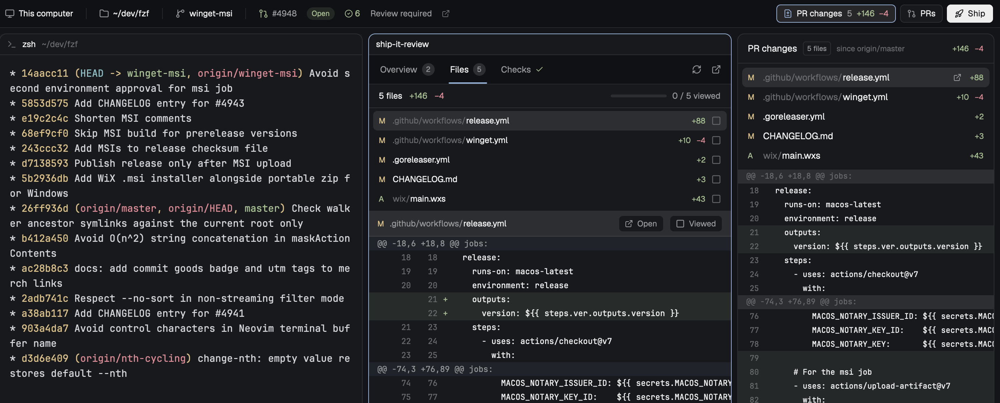

# Ship it

A launch pad for the work you are doing. A fixed strip under the tab bar
always says where that work is: which folder, and which pull request, with its checks, conflicts, open review threads and
review state. Four buttons take you from there to shipping it: the **PR**
(number, state and title; it opens the review), **changes** (the file count
and `+/−` of what the branch changes since its base, in the side panel; double-click a
file to open it whole in a pane), **PRs** (the repo's open pull requests)
and **Ship** (merges the PR, after a confirm). The PR's state, checks and
threads open the review in the side panel (a pane to the right when the
layout has no review panel), with three tabs: **Overview** (the
description, the conversation and a comment box), **Files** (every change
since the base, "viewed" marks, inline review threads) and **Checks**
(failing first, the failed log's tail, re-run).



## What you see

Colours are theme names. "Amber" is `ansi3`: pending checks, modified
files, uncommitted changes, outdated threads. (The theme's `blocked` colour
is red-orange in some themes and reads as failure, so it is not used.)
Red is `ansi1` (failed, deleted, conflicts), green `ansi2` (passed, added).

### The strip (`ship-it`)

One row, 40px high, full width of the work column, directly under the tab bar
and above the panes. Background `chrome`, a 1px `border` line at the bottom,
10px horizontal padding. Text 12px in the UI font. Icons 14px, tinted with
the text colour. Groups are separated by a 1px × 16px `border` rule with
12px margins. Each clickable group is 28px high, 6px horizontal padding,
radius 6, `hover` background. The machine and the branch are not on it:
Herdr's status bar shows both. Left to right:

1. **Folder.** A `folder` icon and the repo root with home shortened to `~`.
   A subfolder of the repo follows in `dim`. Truncates from the left. The
   folder and item 2 share the width the buttons leave (`flex_1`, `min_w(0)`,
   overflow hidden), so nothing runs under the buttons.
2. **What the PR waits on.** Hidden outside a repo, in a repo without a
   remote, on the default branch when it has no PR, and when there is nothing
   to say. Otherwise:
   - **Conflicts** in red with a `git-merge` icon, when GitHub says the PR
     conflicts with its base.
   - Open review threads: `message-square` n in `accent`.
   - The review decision: "Approved" (green), "Changes requested" (red),
     "Review required" (`muted`).
   - With `gh` missing or logged out: "gh unavailable" in `dim`, the
     reason in its tooltip.
3. **Buttons**, 8px after the rest, never shrinking: 26px high, radius 6, 9px horizontal padding, 1px `border`,
   `background` fill, `hover` on hover:
   - **PR**, first: the state icon (`git-pull-request`, `-draft`, `-closed`,
     `git-merge`) in the state's color, `#123` in `muted`, a state pill
     (**Open** `ansi2`, **Draft** `muted`, **Merged** `ansi5`, **Closed**
     `ansi1`; 18px, radius 9, 10.5px semibold, tinted background at 13%,
     `22` alpha), and the title's first 30 characters (then `…`), hidden
     when the strip is narrow. The full title is its hover text. While the
     review panel is open on this repo: `accent` border, `selected` fill.
     With no PR on a feature branch: **Create PR** (`git-pull-request`).
   - **Changes** (`file-diff`, no label) with the branch's file count (`muted`),
     `+add` (green) and `−del` (red); the counts hide when nothing differs.
     While Changes is open on Since main: `accent` border, `selected` fill.
     (Herdr's own Changes, for uncommitted work, stays in the tab bar.)
   - **CI**: `circle-check` n (green), `circle-x` n (red, failed and
     cancelled), `circle-dot` n (amber, pending); only non-zero counts show,
     and the button hides when there are none (no checks, or only skipped).
     Opens the review on **Checks**; `accent` border while it is open there.
   - **PRs** (`git-pull-request`) with the open count, when the repo has a
     GitHub remote. Toggles the Pull requests panel.
   - **Ship** (`rocket`), solid (`solid` / `solid_foreground`) when the PR
     can merge; quiet, with the reason as its hover text, when it can't
     (no PR, draft, conflicts, merged, closed). "Shipping…" while the merge
     runs; once merged it reads **Shipped** with a `git-merge` icon, dim.
     The PR title is not on the strip: it is the PR group's hover text.

Narrower than 900px, the folder shows only the repo name.

### The Changes panel (`ship-it-changes`)

A side panel in the `panel-body` stack, drawn exactly like Herdr's Changes
panel, and in its place: the layout's `changes` block holds it, so the tab
bar's Changes button opens it. Two views, kept in shared
`ship-it.changes` (`{mode: "dirty" | "branch"}`): **Uncommitted** (the
working tree against `HEAD`, with Herdr's commit box: a message input and
**Commit**, which runs `git add -A` then `git commit -m`) and **Since
<base>** (what the branch changes since its base). The strip's changes button
opens it on Since <base>. Double-click a file (or its
open icon) to open it whole, read-only, in a `ship-it-file` pane; the review
pane's Files view has the same as an **Open** button and `e`:

- Header: "Changes", the two views as a segmented control (Uncommitted,
  Since main), an `n files` chip, `+add −del`.
- File list (at most 200px): status letter (A green, D/U red, M amber),
  folder in `dim` and name, an amber dot when the file also has uncommitted
  edits, `+n −n`. The first file is open until you pick another; a click
  on the open file closes it.
- Below: the picked file's diff against the merge base, with line numbers,
  in the terminal font. No commit box.
- Empty: "No changes since origin/main", "Not a git repository", "No base
  branch to compare with".

### The Pull requests panel (`ship-it-prs`)

A side panel in the same stack, framed like Herdr's panels (radius 10, 1px
`border`, `background`), text 13px:

- Header, 42px: "Pull requests" semibold, an `n open` chip with the repo's
  total open count (10px, 1px `border`, radius 4, `muted`), and on the right
  a 22px refresh button.
- Filters, a row of three 24px segments: **All**, **Mine**, **To review**.
  The chosen one has the `selected` fill and `foreground` text; the others
  are `muted`. Each is a GitHub search, not a filter of the loaded rows:
  `sort:updated-desc`, `author:@me sort:updated-desc`,
  `review-requested:@me sort:updated-desc`.
- 10 rows at first. While GitHub may have more, a 28px **Load 10 more**
  button (1px `border`, radius 7, `muted`) ends the list and asks for the
  next 10 ("Loading…" meanwhile). A long list made one heavy query that
  GitHub sometimes answered with a 504.
- Commands, for keys: `ship-it-prs.more`, `ship-it-prs.refresh`,
  `ship-it-prs.all`, `ship-it-prs.mine`, `ship-it-prs.review`.
- Rows (7px vertical padding, radius 7, `hover` fill), newest update first:
  - line 1: the state icon (green open, `muted` draft), the title in
    `foreground`, truncated, and a checks icon on the right (`circle-x` red,
    `circle-dot` amber, `circle-check` green; none when the PR has no checks);
  - line 2, 11px `dim`, indented under the title: `#n` in `muted`, the
    author, "· 3h", "· this branch" in `accent` for the current branch's
    PR, then on the right the review decision ("Approved" green, "Changes
    requested" red) and `+add −del`.
  - The current branch's PR has the `selected` fill.
- Empty: "No open pull requests", "No open pull requests of yours",
  "Nothing waiting for your review", "No GitHub remote", "gh is not logged
  in".

### The file pane (`ship-it-file`)

A mod pane with one file, read-only: a 36px header (the folder in `dim`, the
name semibold) over Herdr's code view (`Editor`, line numbers, syntax colours
from the theme's ANSI colours, the terminal font at 12px). "Binary file · no
text preview" or "This file is not there now (deleted on this branch?)"
when it can't show it.

### The Ship confirm

Herdr's own `confirm` dialog, 420 × 200: "Ship #720?" and "Squash and merge
`head` into `base`. Note: 2 checks failing, not approved yet, 1 open thread.
The branch stays." (the Note only lists what applies).

### The review (`ship-it-review`)

A side panel in the `panel-body` stack, like PR changes; in a layout
without that block, a mod pane framed like any pane. As a panel (no props)
it follows the strip's repo (`ship-it.base`) and switches to a newer
`ship-it.target` without offering; as a pane it keeps its repo. Text 13px in the UI font, background
`background`.

- **Header**, 42px, `chrome`, `border` line below. Three text tabs,
  12.5px medium: **Overview**, **Files**, **Checks**. The selected tab is
  `foreground` with a 2px `accent` bar at its bottom edge, the others
  `muted`. Each carries an 18px count badge on `raised`: Overview the
  number of comments and reviews, Files the file count, Checks the failing
  count in red, else the pending count in amber, else a green check. On the
  right: `git-branch`, `branch → base` in 11.5px `muted` (hidden under
  520px), then 26px icon buttons: refresh (spins while loading) and Open on
  GitHub.
- **Footer**, 28px, `chrome`, 11px `dim` key hints for the tab.

**Overview.** One centred column, max 860px wide, 20px side padding,
16px gaps, scrolling:

- A state pill (22px, icon and label) and `#123` with a `copy` icon.
- The title, 17px semibold, line height 1.3.
- "**author** wants to merge `head` into `base` · opened 3d ago". Branch
  names are chips: 20px, `raised`, the terminal font at 11px.
- `16 files +860 −23`.
- Fact chips: a checks chip (opens Checks), the review decision, the merge
  state ("Ready to merge", "Merge blocked", "Behind base", "Has conflicts",
  "Checks failing", "Draft"), labels in their GitHub colours, and
  "Waiting on …" for requested reviewers.
- **Conflicts with main**, when the PR conflicts: a card with a red border
  at 40%, a red-tinted 36px header with the file count and a **Copy
  details** button, the conflicting files in the terminal font (each opens
  that file in Files), and a note: "Merge or rebase origin/main locally to
  resolve. Compared with your last fetch of main."
- **Open threads**, when any review thread is unresolved: a card with an
  `accent` border at 33%, newest first. Each row: `path:line` in the
  terminal font, an "Outdated" pill when it is, the comment count and age,
  then the first comment's author and one line of its text. A click opens
  the file in Files with that thread in the drawer.
- The description in a card: a 34px `raised` header ("**author** wrote ·
  3d ago"), then the body as markdown (`TextView.markdown`, HTML comments
  removed), or "No description." in italic `dim`.
- "CONVERSATION" (11px semibold `muted`) and a rule, then every comment and
  review, oldest first, as the same cards ("commented", "approved",
  "requested changes", "reviewed"). Approvals have a green border,
  change requests a red one. A review with no body is one 30px line.
- The **comment box** is pinned at the bottom, on `chrome`, aligned to the
  same column: a 2–8 row textarea (radius 8, `accent` border while typing)
  and a **Comment** button (`solid` when there is text).

Without a PR: "No pull request for <branch>" and a **Create pull request**
button. Without `gh`: "GitHub is not reachable" and the reason.

**Files.**

- A 34px summary: `35 files +2444 −432`, and on the right an 80px progress
  bar and `5 / 35 viewed` (green when all are viewed).
- **File list**, up to 240px high (92px while the thread drawer is open),
  virtual, 28px rows: status letter (`A` green, `M` amber, `D` red, `U`
  red), folder in `dim` and file name in `foreground`, an amber dot for
  files with uncommitted changes, an `accent` thread count, `+n −n`, and a
  `square` / `square-check` viewed box. Viewed rows fade to 50%. The open
  file has the `selected` background.
- **File header**, 36px on `raised`: status, path, "● uncommitted", an
  "n threads" chip that opens the drawer, an **Open** button
  (`external-link`, opens the file from the worktree in the file pane;
  hidden for deleted files) and a **Viewed** toggle (green when on).
- **Diff**, the rest: the terminal font at 11.5px, 20px rows, virtual,
  scrolling both ways. Columns: a 30px thread gutter, old line number, new
  line number (38px each, `dim`), the sign, the text. Added rows on green
  at 11%, removed on red at 11%, hunk headers on `accent` at 7% in `muted`.
  A row with review threads shows a chip in the gutter (`accent` with the
  comment count when open, `raised` when resolved); a click on the row
  opens the drawer.
- **Thread drawer**, 42% of the pane's height (at least 180px), on
  `chrome`: a header with the file and line and a close button, each
  thread as a card ("Line 12" / "Resolved" / "Outdated", **Reply**,
  **Resolve** or **Reopen**), its comments as markdown, and a reply box
  with a **Reply** button.

**Checks.**

- A 40px summary: "2 failing" (red), "3 running" (amber) or "All checks
  passed" (green), then "11 passed · 3 skipped", and on the right **Re-run
  failed** (`rotate-ccw`) when a failed check belongs to a GitHub Actions run.
- Groups **FAILING**, **PENDING**, **PASSED**, **SKIPPED** (11px semibold
  `muted` with a count). 34px rows: a status icon (`circle-x` red, a
  spinning `loader` amber, `circle-check` green, `circle-minus` `dim`), the
  name (12.5px medium), the workflow in `dim`, the check's description
  (over 640px wide), the duration (or time running), and an
  `external-link` button.
- Clicking a failed check opens its **log** below the list: a 34px header
  (`circle-x`, the job name, "last 200 lines", close) and the lines in the
  terminal font at 11px, 18px rows, numbered. Lines with `##[error]`,
  `error`, `FAIL` or `panic:` are red on a red tint; `##[group]` lines
  `muted`.

When the strip points at a different repo than the pane shows, a 36px bar
on `accent` at 10% says "The strip is on ~/dev/other" with **Switch** and
a close button.

## How it behaves

### Strip

- **Which folder.** The strip follows the focused pane's live folder, on
  the machine of the active space (or of a focused remote terminal block).
  With a mod pane focused it keeps the last terminal's folder in this
  space, else the first terminal of the same tab, else the space's folder.
- **Refresh.** On every focus or space change (checked in `render`), on
  `watchFolder` events for local repos (a burst settles for 1 s into one
  refresh), and on a timer: every 5 s for remote repos, every 30 s for
  local ones. PR facts, checks and review threads load on branch change,
  then every 30 s while checks are pending, else every 2 minutes. A load
  for a branch you've left never blocks the next one, and its results are
  dropped. The base and the counts always belong to the branch they were
  computed for. The strip redraws only when what it shows changed.
- **Clicks.**
  - Folder: toggles the Files panel.
  - **PR**: opens the review on **Overview** (it has the GitHub link).
    Conflicts, threads, review decision: the same. Checks: on **Checks**.
  - **Create PR**: `gh pr create --web`.
  - **Changes**: opens the Changes panel on Since <base>; a second click
    closes it.
  - **PRs**: toggles the Pull requests panel. A row opens its details and
    actions; its number copies the link. Filters: All, Mine, To review.
  - **Ship**: asks first (Herdr's `confirm` dialog: how it merges, what
    into, and any failing or running checks, missing approval or open
    threads), then `gh pr merge <n> --squash|--merge|--rebase
    --match-head-commit <sha>` (the first method the repo allows). A push
    after the dialog opened makes GitHub refuse. The branch is not deleted.
  - Opening the review selects and shows the `ship-it-review` panel (a
    second click on the same tab hides the panel). Without that block it
    focuses this tab's review pane if one exists, else splits one to the
    right of a pane in the tab on screen.
- **Agent status** (working, blocked, done, idle) does not show anywhere in
  Ship it; Herdr's own agents list and pane headers show it.

### Panels and the file pane

- **Changes:** a click on a file shows its diff; a click on the open
  file closes it; a double-click, or the open icon on the selected row,
  opens it in the file pane. The file pane is this tab's if it has one
  (it switches to the new file), else a new one split to the right.
- **Pull requests:** a row opens the PR on GitHub; `#n` copies its link and
  shows a toast; the filters switch at once; refresh reloads. It reloads
  every 60 s while shown.
- **File pane:** follows edits to the file (folder watch, 1.5 s settle);
  remote files reload every 15 s.
- **Cached:** each mod keeps its last facts for the 12–24 most recent repos
  or branches (`Recent` in `data.js`) and shows them at once on the way back.
  The strip asks GitHub again on arrival when they are over 20 s old, and a
  fetch that finishes after the person left still fills the cache.
- **Lazy:** a panel that isn't the one showing, and a review or file pane
  in a tab that isn't on screen, does no work: a timer tick or file change
  only marks it stale, and it catches up when it shows.

### Review pane

- **What it compares.** The working tree against the merge base of `HEAD`
  and the base: the PR's base as `origin/<base>`, else `origin/HEAD`, else
  `main`, else `master`. This is what the PR will hold after your next push.
- **Files.** Up to 1,000 files and 1,500 lines per diff (with a note).
  Untracked files show as added. Binary files say so.
- **Viewed.** `v`, the file header's **Viewed**, marks the open file. The
  mark stores the file's base and current blob hashes (`git hash-object`),
  so any change to either side clears it. Kept per machine, repo and path
  in `localStorage`.
- **Threads.** RIGHT-side threads map to new line numbers, LEFT-side to
  old. Outdated threads have no line: they show in the file header's chip,
  in Open threads, and in the drawer.
- **Refresh.** On open, on `r`, when the strip asks, and every 10 s for
  remote repos. Local repos refresh the file list on `watchFolder` events
  (1.5 s settle). Checks reload every 20 s while any is pending. The file
  list and diffs load only while the Files tab shows (the tab badge uses
  GitHub's file count until then), and start in parallel with the GitHub
  calls when the strip already knows the base.
- **Keys** (pane focused, not typing): `1` `2` `3` tabs, `r` refresh, `o`
  open on GitHub, `esc` closes the drawer or log. Files: `j`/`down`,
  `k`/`up`, `v`, `n` next unviewed (wraps), `e` open the file in the file
  pane. Checks: `j`/`k` move, `enter`
  opens the log of a failed check or the link of another. In a text box
  `⌘↵` / `ctrl-↵` posts and `esc` leaves the box.
- **Commands** (bind in `keys.json` or run with `herdr-app do`, shown
  copies only): `ship-it-review.overview`, `.files`, `.checks`, `.refresh`,
  `.next`, `.prev`, `.next-unviewed`, `.open-file`, `.threads`, `.log`,
  `.file:<path>`. Ship it needs no `keys.json`: every key above works with
  the pane focused.
- **Writes to GitHub**, each only on a click: Comment (`gh pr comment`),
  Reply and Resolve/Reopen (GraphQL `addPullRequestReviewThreadReply`,
  `resolveReviewThread`, `unresolveReviewThread`), Re-run failed
  (`gh run rerun <run> --failed` per failed run). Failures show a toast.
- **Copy details** (conflicts) puts this on the clipboard:

  ```
  #547 Onboarding email: …
  feat/onboarding-email conflicts with main in 4 files:
    internal/dailybrief/write.go
    …

  To resolve:
    git fetch origin
    git merge origin/main
    # fix the files above, then
    git add <files> && git commit && git push
  ```

## Built from

- **Adding it from this repo** (an agent following AGENTS.md): copy the
  five `mods/ship-it*` folders as they are. Each is complete: the shared
  `data.js`, `files.js` and icons are already copied in, so
  `scripts/install.sh` is optional. The panels and the file pane draw icons
  from `mods/ship-it/icons/`: if `ship-it` must be renamed, change those
  paths too. Then add the four layout blocks below and `herdr-app check`
  each mod. `gh` must be installed and logged in for the PR parts.
- **Five mods**, no layout of their own:
  - `mods/ship-it/`: `main.js` (the strip), `data.js` (git and GitHub
    facts), `mod.json` `{"place": "none", "title": "Ship it"}`, `icons/`.
  - `mods/ship-it-review/`: `main.js` (the pane), `files.js` (branch diff,
    diff rows, log tail), a copy of `data.js` and `icons/`, `mod.json`
    `{"place": "none", "title": "Review"}`.
  - `mods/ship-it-changes/`: `main.js` (the panel), copies of `data.js`
    and `files.js`, `mod.json` `{"place": "none", "title": "Changes"}`.
  - `mods/ship-it-prs/`: `main.js` (the panel), a copy of `data.js`,
    `mod.json` `{"place": "none", "title": "Pull requests"}`.
  - `mods/ship-it-file/`: `main.js` (the file pane), `mod.json`
    `{"place": "none", "title": "File"}`. Props `{ root, on, path }`.
  - `scripts/install.sh` copies `data.js`, `files.js` and `icons/` into
    the mods that use them (a mod can't import from another mod's folder),
    installs the five into `${HERDR_APP_HOME:-~/.config/herdr-app}/mods/`
    and checks them; `--layout <name>` then adds the four blocks with
    `scripts/add-to-layout.py` (once, with a backup; it refuses Herdr's
    read-only `main`, `terminals` and `win98`). `--sync` only refreshes
    the copies.
- **Layout change**, in the person's own layout (clone a shipped one
  first): one block in the work column, between the tab bar and the pane
  area, and three children in the `panel-body` stack, after `changes`. Nothing
  else changes.

  ```json
  { "id": "ship-it", "type": "block", "size": { "px": 40 }, "content": { "mod": "ship-it" } }
  { "id": "ship-it-changes", "type": "block", "content": { "mod": "ship-it-changes" } }
  { "id": "ship-it-review", "type": "block", "content": { "mod": "ship-it-review" } }
  { "id": "ship-it-prs", "type": "block", "content": { "mod": "ship-it-prs" } }
  ```

  The buttons need the shipped `panel` column and `panel-body` stack: PR
  changes and PRs hide without their children, the review falls back to a
  pane, and the folder click needs
  `files`.
- **The pane's props:** `{ root, on, tab }` (repo root, machine, first tab).
  The strip also sets `shared("ship-it.target") = { root, on, tab, at }`
  when it opens or focuses a pane; a pane follows a newer target's `tab`
  when the root matches, and offers **Switch** when it doesn't.
- **Shared state:** `ship-it.target` (above), `ship-it.base` `{ root, on,
  ref }` (the strip's base, read by the panel and the review pane),
  `ship-it.pr` `{ root, on, branch, at, kind, pr, checks, threads }` (the
  strip's pull request with its details, checks and threads: the review
  uses it while it is under a minute old and adopts each newer one, and asks
  GitHub itself only on `r` or after posting),
  `ship-it.prs` `{ root, on, count }` (the PR list's count, shown on the
  PRs button), `ship-it.file` `{ root, on, path, at }` (which file the
  file pane shows). Each is written only when its value changes.
- **`herdr` functions:** `spaces`, `panes`, `focused`, `layout`, `theme`,
  `settings`, `props`, `shared`, `setShared`, `run`, `exec`,
  `readTextFile`, `watchFolder`, `notify`, `nextCommand`, `openOverlay`,
  `home`; `localStorage`. gpui-base: `v_virtual_list` (with
  `on_item_click`, `track_scroll`), `Scrollbar`, `TextView.markdown`,
  `TextareaState` / `Textarea`, `EditorState` / `Editor`. `cx.sleep` for
  the watch settle.
- **Shipped mods used:** `confirm` (the Ship dialog, opened with
  `openOverlay({ mod: "confirm", kind: "dialog", props: { title, detail,
  command: { name: "ship-it.merge" } } })`; the strip gets `merge` from
  `nextCommand()` and merges what it stored when it opened the dialog,
  if under 2 minutes old), `toast` (through `notify`).
- **Commands:** `layout.select`, `layout.show`, `layout.hide`,
  `pane.split`, `pane.focus`.
- **Programs** (through `exec`, on the space's machine):
  - `git` reads: `rev-parse`, `branch --show-current`, `rev-list
    --left-right --count`, `status --porcelain=v1 -z`, `symbolic-ref`,
    `merge-base`, `diff --numstat -z`, `diff --raw -z`, `diff -- <path>`,
    `ls-files --others`, `hash-object`, `merge-tree --write-tree
    --name-only`. Every one uses `--no-optional-locks -c
    core.fsmonitor=false -c diff.autoRefreshIndex=false`.
  - `grep -IcH ""` on untracked files, to count their lines without
    reading them into the script.
  - `gh pr view --json …`, `gh pr checks --json …`, `gh pr list --state
    open --limit 10 --search … --json …` (more on Load more), `gh api
    graphql` (the open total, `totalCount`), `gh repo view --json
    squashMergeAllowed,mergeCommitAllowed,rebaseMergeAllowed`, `gh api
    graphql` (review threads; reply, resolve, unresolve), `gh pr comment`,
    `gh run view --job <id> --log-failed`, `gh run rerun <id> --failed`,
    `gh pr merge <n> --squash|--merge|--rebase --match-head-commit <sha>`,
    `gh pr create --web`.
- **Checks** come from `gh pr checks --json`, grouped by its `bucket`
  (`fail` and `cancel` count as failing). Run and job ids are parsed from
  each check's Actions link; checks from other apps only open their link.
- **Art:** Lucide icons (ISC), copied into each mod's `icons/`.
- No network access of its own. `gh` reaches GitHub with the person's login.

## Watch out

- **`props()`, not `init`'s argument.** A mod pane's props arrive through
  `props()`; the first argument of `init` was empty. Read them in `init`
  and again in `render` if they arrive late.
- **`props()` holds no pane id**, so a pane can't tell whether the strip's
  shared target was meant for it. Never switch repo silently on a shared
  value: every review pane in every tab would follow.
- **Split from the tab on screen.** `focused().pane` can still be a pane in
  another space's tab. Splitting from it put the review pane in the wrong
  tab. Check `pane.tab === focused().tab` first.
- **Races on switch.** A "busy" flag shared by all branches drops the new
  branch's load for good. Key busy flags and the base by branch (strip) or
  by a generation counter (pane), and reset busy flags when the pane
  resets.
- **Builder arity.** `flex_shrink()` needs a number; it threw only when a
  file row was drawn, which `herdr-app check` never does. Use
  `flex_shrink_1()`. `line_height(n)` with a plain number is a multiplier.
- **Virtual lists** take no handlers inside the row renderer: use
  `on_item_click` with the row key.
- **`gh` log text** spells colour codes as `^[[36;1m` when it isn't on a
  terminal, and starts lines with `job<TAB>step<TAB>timestamp`: strip both.
- **`merge-tree` stores loose objects** in `.git`. Run it only when GitHub
  reports a conflict, and never from the folder-watch path, or the watch
  loops.
- **Conflicts compare with the last fetch** of the base, not GitHub's.
- **Git reads must not write**: without the read flags `git status`
  refreshes the index, the folder watch sees it, and refreshes loop.
- **`gh` missing or logged out**, or no git remote: the strip still shows
  the folder. Never toast a poll error.
- **Forks** aren't handled: the base is `origin/<base>`.
- **Remote spaces:** `watchFolder` is local only; they rely on timers.
- The strip is 40px; the review pane wants about 520px of width.
- **Performance.** Every mod redraw redraws the whole window, and `render`
  runs on every change to Herdr's live data (agents, focus, shared state).
  Notify only when what shows changed; write shared state only when its
  value changed; let a folder-watch burst settle into one refresh; poll a
  local repo only as a backstop; follow focus in `render`, not on a timer
  (a slow poll then misses space switches); never read file contents just
  to count lines; keep hidden panels and panes idle.
- **Hidden copies.** A mod pane doesn't know its own pane id, so "shown"
  means a pane of that mod is in the tab on screen. A panel is shown when
  the `panel` column is open and `panel-body`'s active child is its id.
  A load started while hidden can be dropped: guard a "loading" flag with
  a time limit so it can't block forever.
- **Ship merges for real.** Never test it on a PR that shouldn't merge.
  `gh pr merge` needs a method flag when not on a terminal.
- `nextCommand()` gives only the command name, no arguments: keep what the
  confirm should act on in the strip.
- Mods run with the person's full permissions. Say before installing that
  Ship it runs `git`, `grep`, `gh` and the system URL opener, and that
  Comment, Reply, Resolve, Re-run and Ship write to GitHub.

## Done when

- `herdr-app check` passes for all five mods.
- On a feature branch with an open PR, the strip shows "This computer",
  `~/…/<repo>`, the branch, `#<n>`, **Open** (the title on hover), and
  check counts that match `gh pr checks`; pending counts are amber,
  failures red.
- In a repo without a remote, or on `main` with no PR, the PR group is
  hidden. On a branch without a PR it shows "No pull request · Create".
- `cd` into another repo, or switching spaces, updates every group at once,
  including the PR changes counts.
- Clicking `#<n>` copies the PR link; the link button opens it.
- Clicking the PR's state opens the review in the side panel; a second
  click hides it. Without the review block, it opens one review pane to
  the right in the tab on screen, and a second click focuses it.
- **PR changes** opens the panel with the same file count and `+/−` as the
  button; double-clicking a file opens it in the file pane, and opening
  another file reuses that pane.
- **PRs** shows the open-PR total; the panel lists the 10 most recently
  updated, the current branch's PR marked, and Load 10 more adds the next 10;
  Mine and To review list yours and those waiting for your review.
- **Ship** is solid on an open, non-draft, conflict-free PR and dim with the
  reason otherwise; it opens the confirm, and confirming merges (test on a
  throwaway PR) and turns the button to **Shipped**.
- Files: the count and `+/−` match `git diff $(git merge-base HEAD
  origin/<base>) --shortstat` plus untracked files.
- `v` marks a file viewed; editing it clears the mark; marks survive a
  restart.
- A PR with conflicts shows the card with the files from `git merge-tree`,
  and **Copy details** copies them.
- A PR with unresolved threads lists them under Open threads; a click opens
  the file and its thread.
- Checks lists failing, pending, passed and skipped in that order; a
  failed Actions check shows its log tail.
- With `gh` logged out, the strip still shows the folder.
- With the panel closed and the review pane in another tab, no `git` or
  `gh` process starts for them until they show.
- The person's layout is unchanged apart from the four blocks.
